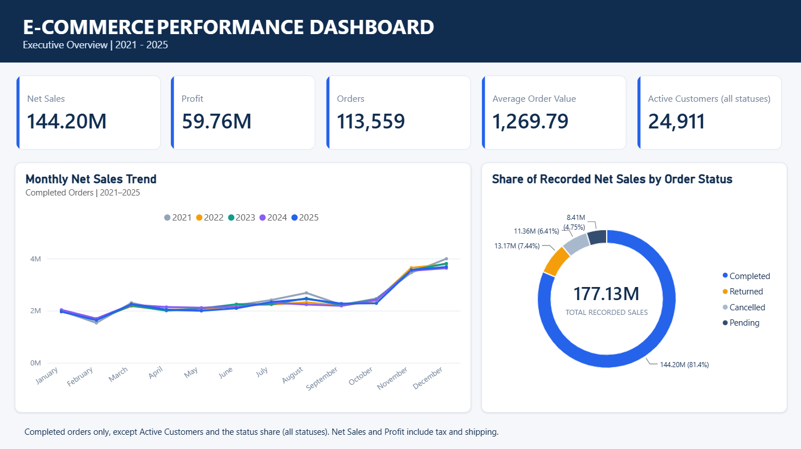
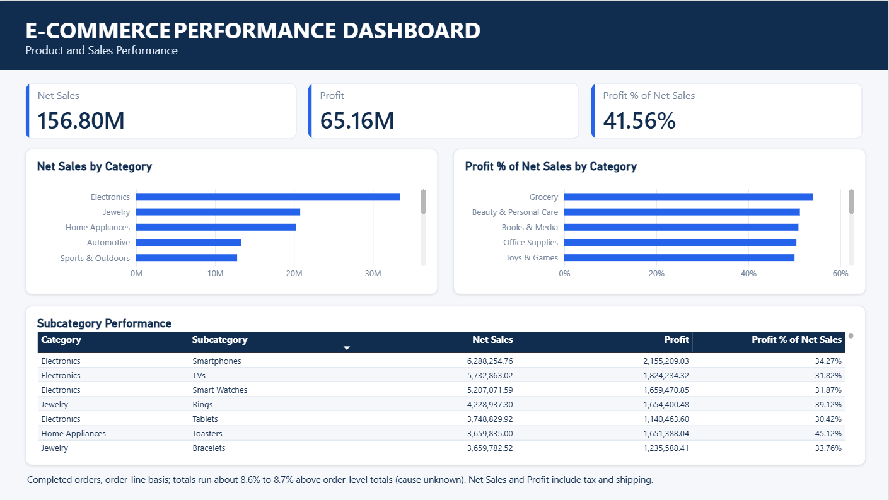
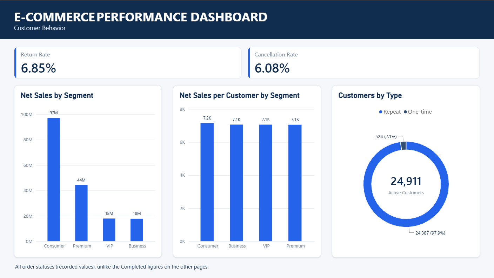

# E-commerce Business Performance & Customer Analytics

End-to-end analysis of an online retailer's sales, product profitability, customers and order outcomes, using SQL (PostgreSQL), Python and Power BI.

## Dashboard

**Executive Overview:** Completed-order headline figures, monthly Net Sales trend and order-status share.


**Product and Sales Performance:** Net Sales and Profit % of Net Sales by category and subcategory (Completed orders, order-line basis).


**Customer Behavior:** segments, repeat vs one-time customers, return and cancellation rates (all order statuses).


## Key findings

Full list with scope and evidence: [`docs/findings.md`](docs/findings.md). All findings are descriptive associations, not causal claims.

- **Seasonality, no trend** [all statuses]: Net Sales peak in November and December and are lowest in February in all five years. Yearly Net Sales change by at most 1.11%, with no consistent direction.
- **Discounts and margin** [all statuses]: discounts reach about 30% of gross sales in Nov and Dec, and the profit-to-Net-Sales ratio is lower in those months (32.3% to 33.6% vs 47.1% to 47.9% in the other months, with July and September in between).
- **Electronics** [Completed, order-line basis]: first in Net Sales (33,486,763.01) and lowest in Profit % of Net Sales (32.58%, against 41.56% overall).
- **Segments** [all statuses]: segment Net Sales follow segment size. Net Sales per customer differs by about 1.4% across segments. Premium and VIP are discounted about 4.5 points deeper.
- **Delivery** [Completed]: average rating falls with later delivery (Early 4.02, On Time 3.73, Delayed 3.22). Association only.
- **Returns and cancellations** [all statuses]: rates stay close to 6.85% and 6.08% in every segment and channel.

## Recommendations

Actions to investigate or test, each tied to a finding: [`docs/recommendations.md`](docs/recommendations.md). They cover seasonal discounts, Electronics pricing, Premium and VIP discounts, delivery delays and retention metrics.

## Tools

| Tool | Used for |
|---|---|
| PostgreSQL, pgAdmin 4, SQL | CSV import into a `raw` schema, data profiling, cleaning into an `analytics` schema, business analysis |
| Python (pandas, SQLAlchemy, matplotlib) | EDA notebook: distributions, median checks of the SQL findings |
| Power BI and DAX | Semantic model, tested measures, three dashboard pages |
| Git and GitHub | Version control. The Power BI report is saved as a PBIP project (text files) |

## Data

Kaggle [E-Commerce Sales Analytics Dataset](https://www.kaggle.com/datasets/datascikhan/e-commerce-sales-and-customer-analytics/data) by datascikhan, license CC0 (public domain). Five CSVs: orders (138,116 rows), order lines (397,569), customers (25,000), products (1,175) and a one-row reference statistics file. Orders span 2021-01-01 to 2025-12-31. The source has no data dictionary, so column meanings are inferred from arithmetic.

The data is not included in this repository. The Power BI project connects to a local PostgreSQL database named `ecommerce_analytics`.

## Method and key decisions

- **Raw and analytics layers:** the raw tables are never changed. Cleaning is done in SQL (types, rounding, flags, a date table, a repeat-customer type), and key checks are saved queries with result comments.
- **Reconciliation:** the order table matches the dataset's reference statistics to the cent (Net Sales 177,134,263.74, Profit 76,146,395.76, 24,911 customers, return rate 6.85%).
- **Two fact tables:** orders and order lines do not reconcile (order lines run about 8.6% higher, cause unknown), so order-level measures come only from orders, product-level measures only from order lines, and the two are never mixed in one visual.
- **Headline scope:** dashboard headline figures use Completed orders only, an assumed business rule (no real stakeholder was involved). All-status measures are kept to reconcile with the reference statistics.
- Measures were tested against reference values, saved SQL results or hand calculations
- Details: [`docs/assumptions_and_decisions.md`](docs/assumptions_and_decisions.md), [`docs/data_quality_log.md`](docs/data_quality_log.md), [`docs/model_design.md`](docs/model_design.md).

## Limitations

- No data dictionary. `net_sales` and `profit` include tax and shipping.
- Order-line totals do not reconcile with order totals (about 8.6%, cause unknown).
- Delivery and rating analysis covers Completed orders only. Return reasons were not analyzed, and no cancellation reason exists.
- Findings are associations. Discounts and delivery are analyzed in SQL but not shown on the dashboard.

## Project flow

```
Kaggle CSVs (5 files, not in repo)
    │
    ▼
pgAdmin 4 import ──► PostgreSQL: raw schema (untouched)
    │                 sql/01_create_schemas.sql
    │                 sql/02_create_raw_tables.sql
    ▼
sql/03_data_profiling.sql ──► docs/data_quality_log.md
    │                         docs/assumptions_and_decisions.md
    ▼
sql/04_create_analytics_tables.sql
    │
    ▼
PostgreSQL: analytics schema
    │   sales, order_items, customers, products, dates
    │
    ├── sql/05_business_analysis.sql ──► docs/findings.md
    │                                    docs/recommendations.md
    │
    ├── notebooks/01_eda.ipynb ──► cross-checks SQL results (medians, distributions)
    │
    └── powerbi/*.pbip
           ├── semantic model (relationships, DAX measures)
           └── 3 report pages ──► docs/images/*.png
                  ├── Executive Overview
                  ├── Product and Sales Performance
                  └── Customer Behavior
```

## Project structure

```
ecommerce-performance-analytics/
├── README.md
├── requirements.txt
├── .gitignore
│
├── sql/
│   ├── 01_create_schemas.sql           # raw and analytics schemas
│   ├── 02_create_raw_tables.sql        # raw table definitions (CSVs imported via pgAdmin 4)
│   ├── 03_data_profiling.sql           # data quality checks on raw tables
│   ├── 04_create_analytics_tables.sql  # cleaned tables, date table, customer_type, verification queries
│   └── 05_business_analysis.sql        # business questions with scope, result, takeaway
│
├── data/
│   └── raw/                            # gitignored: Kaggle CSVs
│
├── notebooks/
│   └── 01_eda.ipynb                    # distributions and median checks of the SQL findings
│
├── powerbi/
│   ├── ecommerce_performance_dashboard.pbip
│   ├── ecommerce_performance_dashboard.SemanticModel/   # tables, relationships, DAX measures (text)
│   └── ecommerce_performance_dashboard.Report/          # 3 report pages (text)
│
└── docs/
    ├── project_brief.md                # scenario, questions, tools, approach
    ├── data_quality_log.md             # checks and findings per table
    ├── assumptions_and_decisions.md    # dated decisions with evidence
    ├── cleaning_plan.md                # column-level cleaning actions
    ├── model_design.md                 # relationships, measures, tests
    ├── findings.md                     # supported findings, open questions, limitations
    ├── recommendations.md              # actions to investigate, tied to findings
    └── images/                         # model diagram and dashboard screenshots
```