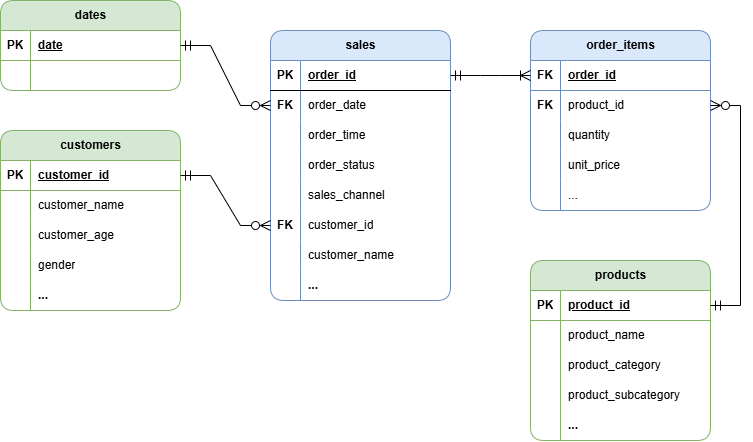

# Model Design

Design of the Power BI semantic model, built from the cleaned `analytics` tables.
Facts, relationships and measure rules follow the grain of each table and the decisions in `assumptions_and_decisions.md`.

## 1. Tables

| Table | Role | Grain | Key | Rows |
|---|---|---|---|---|
| `analytics.sales` | Fact (order header) | One row per order | `order_id` | 138,116 |
| `analytics.order_items` | Fact (order line) | One row per order line | None. `(order_id, product_id)` repeats for 87 pairs, so it is not unique | 397,569 |
| `analytics.customers` | Dimension | One row per customer | `customer_id` | 25,000 |
| `analytics.products` | Dimension | One row per product | `product_id` | 1,175 |
| `analytics.dates` | Dimension | One row per day | `date` | 1,826 |

## 2. Relationships

Crow's foot notation. Each marker shows how many rows of the table at that end a row on the other side relates to. Key columns only.

| From (one) | To (many) | Dimension end | Fact end | Evidence |
|---|---|---|---|---|
| `customers[customer_id]` | `sales[customer_id]` | Exactly one | Zero or many | 0 sales rows without a customer. 89 customers have no orders |
| `dates[date]` | `sales[order_date]` | Exactly one | Zero or many | All order dates fall in 2021-01-01 to 2025-12-31 |
| `sales[order_id]` | `order_items[order_id]` | Exactly one | One or many | 0 orders without lines, 0 lines without an order |
| `products[product_id]` | `order_items[product_id]` | Exactly one | Zero or many | 0 lines without a product. A catalog can hold unsold products |

All relationships are single-direction, one-to-many. Power BI does not enforce optionality, so the diagram documents the data.

### Verified in Power BI

Load (Import mode): sales 138,116 | order_items 397,569 | customers 25,000 | products 1,175 | dates 1,826 rows, matching the SQL counts.
All four relationships exist in `relationships.tmdl`, and the Model view shows them as many-to-one, active, single direction. `dates[date]` to `sales[order_date]` was created manually, the other three were auto-detected.

## 3. Rules that prevent double-counting

1. **Order-level measures use `sales` only.** Net Sales, Profit, orders, AOV, returns, cancellations and delivery are all measured on `analytics.sales`, which reconciles with `dataset_statistics`.
2. **Product-level measures use `order_items` only**, and sum line-level columns. `analytics.order_items` totals run about 8.6% above `analytics.sales` (cause unknown), so the two bases are never shown in the same visual or added together.
3. **Never sum order-level columns across the order-line relationship.** A product or category slicer filters `order_items` and does not filter `sales`, so sales measures do not respond to it.
4. **Name measures by source**, for example `Net Sales (orders)` and `Net Sales (items)`. The headline figure is `Net Sales (orders)`.
5. **Group products by `product_category` and `product_subcategory` together.** Three subcategory names (Storage, Watches, Furniture) appear under two categories each.
6. **Count active customers with a distinct count of `sales[customer_id]`**, not rows in `customers`, which includes 89 customers who never ordered.

## 4. Columns to hide or avoid

| Table | Columns | Reason |
|---|---|---|
| `sales` | `customer_segment`, `customer_age`, `gender`, `customer_city`, `customer_state`, `customer_country`, `region`, `customer_postal_code` | Duplicates of `customers`. Use the `customers` columns for slicers (Q5a showed they agree) |
| `sales` | `is_repeat_customer`, `customer_order_count` | They do not match actual orders (Q4). Repeat customers are defined from actual order counts |
| `sales` | `order_id` (as a slicer) | High cardinality |
| `order_items` | `order_id` | Used only for the relationship |

## 5. Measures

Defined in DAX. Net Sales and Profit are dataset-defined measures with no data dictionary, and `profit` includes tax.

| Measure | Definition | Source |
|---|---|---|
| Net Sales (orders) | `SUM(sales[net_sales])` | `sales` |
| Profit (orders) | `SUM(sales[profit])` | `sales` |
| Product Sales (orders) | `SUM(sales[gross_sales]) - SUM(sales[discount_amount])` | `sales` |
| Profit % of Net Sales | `DIVIDE([Profit (orders)], [Net Sales (orders)])` | `sales` |
| Orders | `DISTINCTCOUNT(sales[order_id])` | `sales` |
| Active Customers | `DISTINCTCOUNT(sales[customer_id])` | `sales` |
| AOV | `DIVIDE([Net Sales (orders)], [Orders])` | `sales` |
| Discount % of Gross Sales | `DIVIDE(SUM(sales[discount_amount]), SUM(sales[gross_sales]))` | `sales` |
| Return Rate | Returned orders divided by orders | `sales` |
| Cancellation Rate | Cancelled orders divided by orders | `sales` |
| Net Sales (items) | `SUM(order_items[net_sales])` | `order_items` |
| Profit (items) | `SUM(order_items[profit])` | `order_items` |
| Net Sales MoM / YoY | Time-intelligence measures on `dates` | `sales` |

Reference values to test against: Net Sales 177,134,263.74, Profit 76,146,395.76, Orders 138,116, Active Customers 24,911, AOV 1,282.50, Return Rate 6.85%, Cancellation Rate 6.08%.

## 6. Scope rules for reports

- **Order status:** headline measures include all statuses so they reconcile with `dataset_statistics`. They are recorded values, not realized revenue. Show a status slicer or a Completed-only variant next to them.
- **Product and category pages:** Completed orders only, through the `sales` to `order_items` relationship (decision 2026-11-03).
- **Delivery and rating pages:** Completed orders only. Returned, Cancelled and Pending orders have no delivery data.
- **Repeat vs one-time customers:** defined from actual order counts in `analytics.sales` (1 order = one-time).

## 7. Decisions

| Decision | Choice | Reason |
|---|---|---|
| Date table | Build `analytics.dates` in SQL | Reproducible, consistent with the rest of the project. Turn off Power BI auto date/time |
| `sales` to `order_items` relationship | Keep it, single direction | Lets Completed-only filters reach product visuals. The risk is cross-filter mistakes, handled by the rules in section 2 |

## 8. Pages

1. **Executive Overview:** headline measures, monthly trend, status mix.
2. **Product and Sales Performance:** categories and subcategories (Completed orders, items basis).
3. **Customer Behavior:** segments, order-frequency bands, returns.

## 9. Known limitations

- No data dictionary. Meanings of `net_sales`, `tax_amount`, `shipping_cost` and `profit` are inferred from arithmetic.
- `analytics.order_items` and `analytics.sales` do not reconcile (about 8.6%, cause unknown).
- Delivery and rating analysis covers Completed orders only.
- Net Sales and Profit include tax and shipping.